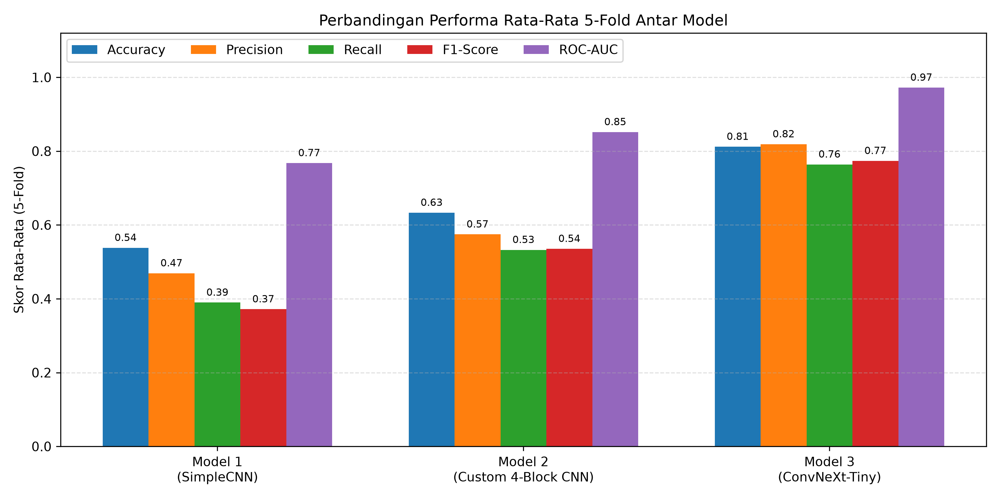
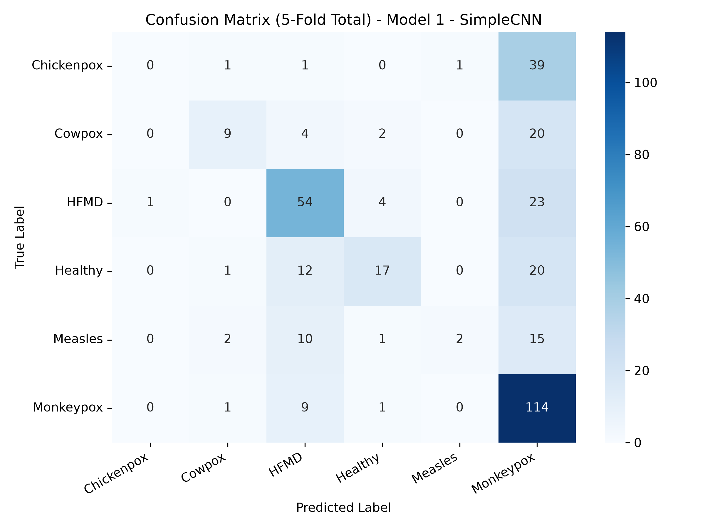
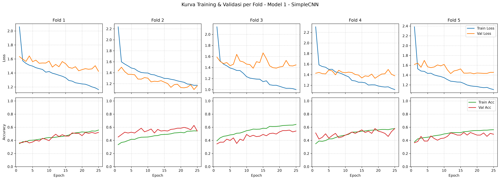
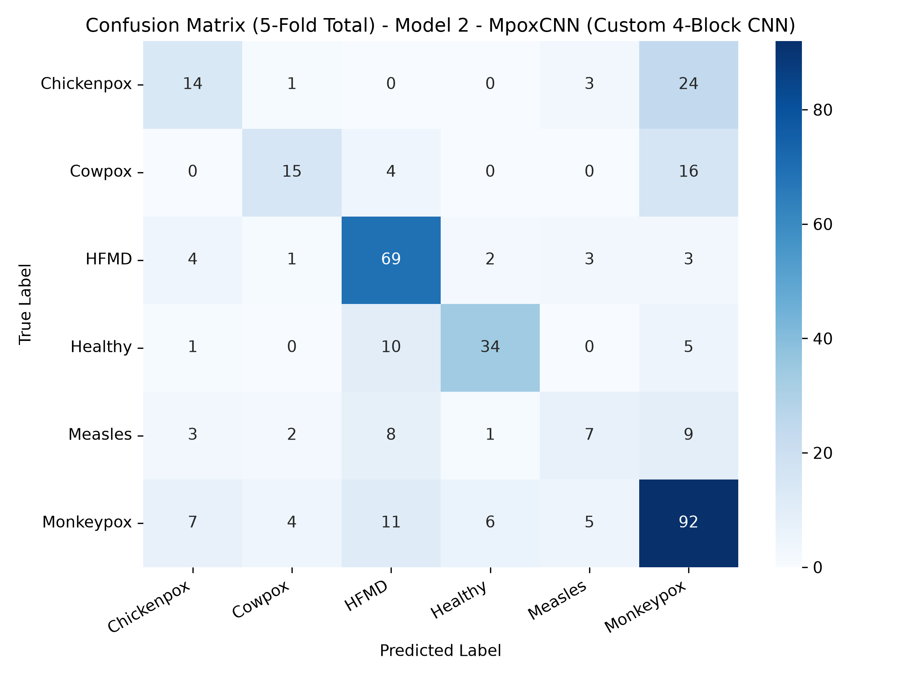
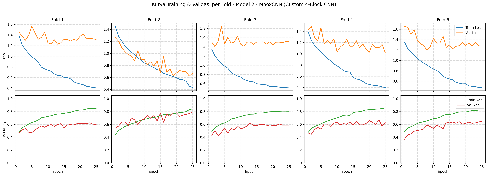
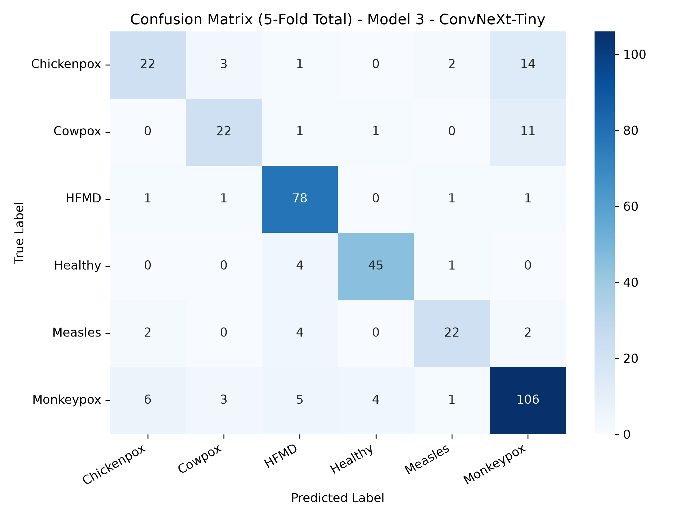
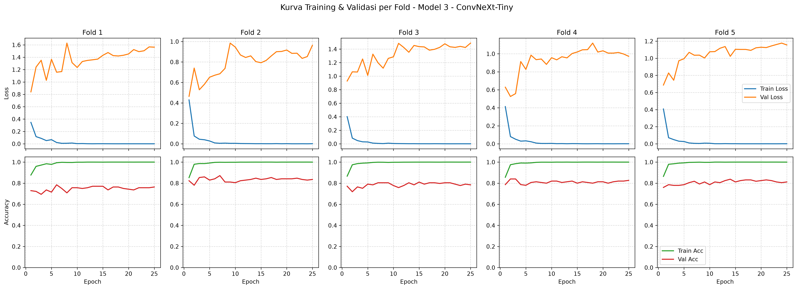

# Klasifikasi Penyakit Lesi Kulit Berbasis Deep Learning (Monkeypox Skin Lesion)

Repositori ini berisi implementasi, evaluasi, dan laporan hasil pengembangan tiga model *Deep Learning* berbasis **PyTorch** dengan skema **5-Fold Cross-Validation** untuk mengklasifikasikan enam kategori citra lesi kulit: **Chickenpox**, **Cowpox**, **HFMD (Hand, Foot, and Mouth Disease)**, **Healthy**, **Measles**, dan **Monkeypox**.

---

## 1. Karakteristik dan Distribusi Dataset

Dataset terdiri dari citra asli (`Original Images`) dan citra hasil augmentasi (`Augmented Images`) yang terbagi ke dalam 5 partisi *Cross-Validation* (`Fold 1` – `Fold 5`). Pada setiap fold, data latih mendapat tambahan augmentasi sebanyak **14 kali lipat** dari jumlah citra asli, sedangkan partisi validasi dan pengujian murni menggunakan citra asli.

| Kelas Penyakit | Original Train | Augmented Train | Total Train | Valid | Test | Total Keseluruhan |
| :--- | :---: | :---: | :---: | :---: | :---: | :---: |
| **Chickenpox** | 50 | 700 | 750 | 16 | 9 | 775 |
| **Cowpox** | 49 | 686 | 735 | 10 | 7 | 752 |
| **HFMD** | 116 | 1.624 | 1.740 | 29 | 16 | 1.785 |
| **Healthy** | 83 | 1.162 | 1.245 | 22 | 9 | 1.276 |
| **Measles** | 37 | 518 | 555 | 12 | 6 | 573 |
| **Monkeypox** | 202 | 2.828 | 3.030 | 55 | 27 | 3.112 |
| **TOTAL** | **537** | **7.518** | **8.055** | **144** | **74** | **8.273** |


### Temuan Utama Distribusi Data:
* **Ketidakseimbangan Kelas (*Class Imbalance*)**: Dataset memiliki distribusi yang tidak seimbang antar kelas. Kelas **Monkeypox** merupakan kelas mayoritas dengan **3.112** citra (`37,6%` dari total data, 202 citra asli), diikuti oleh **HFMD** dengan **1.785** citra (`21,6%`). Sebaliknya, **Measles** merupakan kelas minoritas dengan hanya **573** citra (`6,9%`, 37 citra asli), disusul **Cowpox** (**752** citra) dan **Chickenpox** (**775** citra)—rasio perbandingan antara kelas terbanyak (*Monkeypox*) dan tersedikit (*Measles*) mencapai sekitar **5,4 : 1**.
* **Ukuran Sampel Evaluasi**: Karena partisi `Valid` (144 citra) dan `Test` (74 citra) hanya memakai citra asli tanpa augmentasi, beberapa kelas minoritas memiliki jumlah sampel uji yang sangat kecil (seperti *Measles* 6 gambar dan *Cowpox* 7 gambar per fold), sehingga skema **5-Fold Cross-Validation** sangat krusial agar seluruh sampel asli teruji secara merata.

---

## 2. Pipeline Preprocessing dan Arsitektur Model

### Tahapan Preprocessing (`Utils/getData.py`)
1. **Konversi Ruang Warna & CLAHE**: Citra dikonversi dari `BGR` ke `RGB` lalu ke ruang warna `LAB`. Kanal pencahayaan (`L`) diproses menggunakan *Contrast Limited Adaptive Histogram Equalization* (`clipLimit=2.0`, `tileGridSize=(8, 8)`) untuk mempertegas tekstur dan batas lesi kulit.
2. **Data Augmentasi (Khusus Data Latih)**: Menggabungkan dataset asli (`Original Images`) dan hasil augmentasi statis (`Augmented Images`), serta menerapkan augmentasi acak *on-the-fly* berupa *horizontal flip*, *vertical flip*, dan rotasi kelipatan $90^\circ$ (`rot90`).
3. **Resize & Normalisasi Standar**: Citra diseragamkan ke dimensi $128 \times 128$ piksel dan dinormalisasi menggunakan parameter standar ImageNet ($\mu = [0.485, 0.456, 0.406]$, $\sigma = [0.229, 0.224, 0.225]$).

### Arsitektur Model yang Dikembangkan
- **Model 1 (`SimpleCNN`)**: Arsitektur CNN dasar ringan sebagai *baseline* perbandingan.
- **Model 2 (`MpoxCNN - Custom 4-Block CNN`)**: Arsitektur CNN kustom 4 blok konvolusi dengan regularisasi *Dropout* (`0.5`).
- **Model 3 (`ConvNeXt-Tiny`)**: Arsitektur modern berbasis *transfer learning* untuk ekstraksi fitur spasial mendalam dengan *Dropout* (`0.3`).

---

## 3. Laporan Hasil Pengembangan & Evaluasi Model

### Rekapitulasi Rata-Rata Evaluasi 5-Fold (Test Set)

| Model | Accuracy | Precision | Recall | F1-Score | ROC-AUC |
| :--- | :---: | :---: | :---: | :---: | :---: |
| **Model 1 - SimpleCNN** | `0.5381 ± 0.0205` | `0.4692 ± 0.1318` | `0.3897 ± 0.0310` | `0.3717 ± 0.0400` | `0.7677 ± 0.0425` |
| **Model 2 - MpoxCNN (Custom 4-Block CNN)** | `0.6332 ± 0.0399` | `0.5745 ± 0.1635` | `0.5325 ± 0.1039` | `0.5354 ± 0.1234` | `0.8517 ± 0.0246` |
| **Model 3 - ConvNeXt-Tiny** | **`0.8120 ± 0.0379`** | **`0.8188 ± 0.0641`** | **`0.7640 ± 0.0551`** | **`0.7736 ± 0.0553`** | **`0.9722 ± 0.0103`** |



---

### Detail Evaluasi: Model 1 — SimpleCNN

#### Hasil Evaluasi Per Fold
| Fold | Accuracy | Precision | Recall | F1-Score | ROC-AUC |
| :---: | :---: | :---: | :---: | :---: | :---: |
| Fold 1 | 0.5405 | 0.4235 | 0.3701 | 0.3510 | 0.7575 |
| Fold 2 | 0.5488 | 0.4045 | 0.3544 | 0.3371 | 0.7367 |
| Fold 3 | 0.5625 | 0.7030 | 0.4339 | 0.4396 | 0.7964 |
| Fold 4 | 0.5309 | 0.4293 | 0.4054 | 0.3720 | 0.7226 |
| Fold 5 | 0.5079 | 0.3857 | 0.3847 | 0.3589 | 0.8252 |

#### Performa Per Kelas (Gabungan 5-Fold Test Set — 364 Sampel)
| Kelas | Precision | Recall | F1-Score | Support |
| :--- | :---: | :---: | :---: | :---: |
| **Chickenpox** | 0.0000 | 0.0000 | 0.0000 | 42 |
| **Cowpox** | 0.6429 | 0.2571 | 0.3673 | 35 |
| **HFMD** | 0.6000 | 0.6585 | 0.6279 | 82 |
| **Healthy** | 0.6800 | 0.3400 | 0.4533 | 50 |
| **Measles** | 0.6667 | 0.0667 | 0.1212 | 30 |
| **Monkeypox** | 0.4935 | 0.9120 | 0.6404 | 125 |

#### Confusion Matrix (Akumulasi 5 Fold) — Model 1


#### Grafik Kurva Training & Validation — Model 1



---

### Detail Evaluasi: Model 2 — MpoxCNN (Custom 4-Block CNN)

#### Hasil Evaluasi Per Fold
| Fold | Accuracy | Precision | Recall | F1-Score | ROC-AUC |
| :---: | :---: | :---: | :---: | :---: | :---: |
| Fold 1 | 0.6892 | 0.7372 | 0.6072 | 0.6364 | 0.8644 |
| Fold 2 | 0.6220 | 0.5718 | 0.5325 | 0.5437 | 0.8534 |
| Fold 3 | 0.5781 | 0.3028 | 0.3608 | 0.3272 | 0.8179 |
| Fold 4 | 0.6420 | 0.6453 | 0.6223 | 0.6195 | 0.8829 |
| Fold 5 | 0.6349 | 0.6153 | 0.5397 | 0.5502 | 0.8400 |

#### Performa Per Kelas (Gabungan 5-Fold Test Set — 364 Sampel)
| Kelas | Precision | Recall | F1-Score | Support |
| :--- | :---: | :---: | :---: | :---: |
| **Chickenpox** | 0.4828 | 0.3333 | 0.3944 | 42 |
| **Cowpox** | 0.6522 | 0.4286 | 0.5172 | 35 |
| **HFMD** | 0.6765 | 0.8415 | 0.7500 | 82 |
| **Healthy** | 0.7907 | 0.6800 | 0.7312 | 50 |
| **Measles** | 0.3889 | 0.2333 | 0.2917 | 30 |
| **Monkeypox** | 0.6174 | 0.7360 | 0.6715 | 125 |

#### Confusion Matrix (Akumulasi 5 Fold) — Model 2


#### Grafik Kurva Training & Validation — Model 2


---

### Detail Evaluasi: Model 3 — ConvNeXt-Tiny

#### Hasil Evaluasi Per Fold
| Fold | Accuracy | Precision | Recall | F1-Score | ROC-AUC |
| :---: | :---: | :---: | :---: | :---: | :---: |
| Fold 1 | 0.7703 | 0.7841 | 0.7433 | 0.7323 | 0.9622 |
| Fold 2 | 0.8049 | 0.7472 | 0.6793 | 0.7006 | 0.9695 |
| Fold 3 | 0.7969 | 0.8139 | 0.7762 | 0.7897 | 0.9742 |
| Fold 4 | 0.8148 | 0.8299 | 0.8132 | 0.8159 | 0.9663 |
| Fold 5 | 0.8730 | 0.9187 | 0.8082 | 0.8297 | 0.9889 |

#### Performa Per Kelas (Gabungan 5-Fold Test Set — 364 Sampel)
| Kelas | Precision | Recall | F1-Score | Support |
| :--- | :---: | :---: | :---: | :---: |
| **Chickenpox** | 0.7097 | 0.5238 | 0.6027 | 42 |
| **Cowpox** | 0.7586 | 0.6286 | 0.6875 | 35 |
| **HFMD** | 0.8387 | 0.9512 | 0.8914 | 82 |
| **Healthy** | 0.9000 | 0.9000 | 0.9000 | 50 |
| **Measles** | 0.8148 | 0.7333 | 0.7719 | 30 |
| **Monkeypox** | 0.7910 | 0.8480 | 0.8185 | 125 |

#### Confusion Matrix (Akumulasi 5 Fold) — Model 3


#### Grafik Kurva Training & Validation — Model 3


---

## 4. Analisis Kelebihan dan Keterbatasan Model

### Kelebihan Pengembangan Model
1. **Peningkatan Performa Signifikan Seiring Kedalaman Arsitektur**: Evaluasi menunjukkan lonjakan performa yang konsisten dari arsitektur dasar hingga *transfer learning* modern. **ConvNeXt-Tiny (Model 3)** mencapai rata-rata **Accuracy `0.8120 ± 0.0379`**, **F1-Score `0.7736 ± 0.0553`**, dan **ROC-AUC `0.9722 ± 0.0103`**, meningkat jauh dibandingkan *baseline* **SimpleCNN** (`Accuracy 0.5381`, `F1-Score 0.3717`) maupun **Custom 4-Block CNN** (`Accuracy 0.6332`, `F1-Score 0.5354`).
2. **Stabilitas Generalisasi Antar-Fold**: Skema **5-Fold Cross-Validation** membuktikan konsistensi model terbaik (**ConvNeXt-Tiny**) dengan standar deviasi akurasi yang rendah (`± 0.0379`) dan nilai `ROC-AUC` di atas `0.96` pada seluruh partisi pengujian (`Fold 1` hingga `Fold 5`), menandakan kemampuan separabilitas fitur yang sangat baik.
3. **Efektivitas Pipeline Preprocessing (CLAHE & Augmentasi)**: Kombinasi peningkatan kontras lokal CLAHE pada kanal pencahayaan `LAB` serta augmentasi statis dan dinamis (`flip` dan `rot90`) membantu **ConvNeXt-Tiny** mengenali kelas dengan pola visual khas secara sangat akurat, seperti **Healthy** (`F1-Score = 0.9000`) dan **HFMD** (`F1-Score = 0.8914`, `Recall = 0.9512`).

### Keterbatasan Pengembangan Model
1. **Sensitivitas Terhadap Ketidakseimbangan Kelas (*Class Imbalance*)**: Rasio ketimpangan antara kelas mayoritas **Monkeypox** (3.112 citra) dan kelas minoritas **Measles** (573 citra) berdampak besar pada model berkapasitas kecil. Pada **SimpleCNN**, model mengalami bias kuat ke kelas mayoritas (*Monkeypox* `Recall = 0.9120`), sementara kelas minoritas **Chickenpox** gagal terdeteksi sama sekali (`F1-Score = 0.0000`) dan **Measles** hanya mencapai `Recall = 0.0667`.
2. **Kesalahan Prediksi pada Kelas Lesi Vesikular yang Mirip Secara Visual**: Bahkan pada model terbaik (**ConvNeXt-Tiny**), kelas **Chickenpox** (`F1-Score = 0.6027`, `Recall = 0.5238`) dan **Cowpox** (`F1-Score = 0.6875`, `Recall = 0.6286`) masih menjadi sumber kesalahan klasifikasi utama karena kemiripan morfologi ruam dan lenting kulit dengan **Monkeypox** pada resolusi input $128 \times 128$ piksel.
3. **Trade-Off Komputasi dan Risiko Overfitting**: Arsitektur modern seperti **ConvNeXt-Tiny** memiliki jumlah parameter jauh lebih besar dibandingkan CNN kustom 4-blok, sehingga memerlukan waktu pelatihan lebih lama serta lebih rentan mengalami *overfitting* pada epoch lanjut apabila tidak dikontrol dengan regularisasi *Dropout* dan pemilihan bobot terbaik (*best validation checkpoint*).

---

## 5. Struktur Proyek & Cara Menjalankan

```text
Project/
├── Models/
│   ├── model1/simpleCNN.py
│   ├── model2/mpoxModel.py
│   └── model3/mpoxModel_convnext.py
├── Utils/
│   └── getData.py
├── Results/
│   ├── EDA/distribusi_kelas_semua_fold.png
│   ├── model1\model1_kurva_5fold.png
│   ├── model2\model2_kurva_5fold.png
│   ├── model3\model3_kurva_5fold.png
│   ├── perbandingan_model.png
│   └── test_evaluation_summary.json
├── cek_data.py
├── EDA.py
├── perbandingan_model
├── train.py
├── test.py
└── requirements.txt